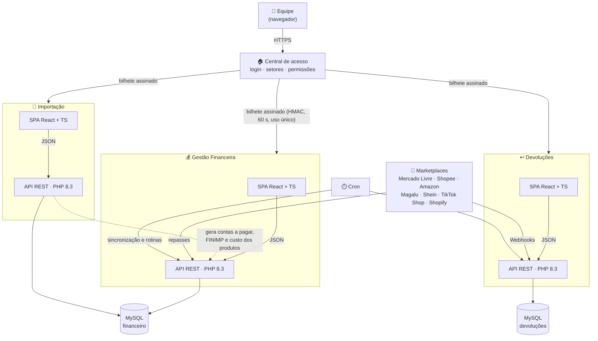

<h1 align="center">Olá, eu sou o Gustavo Cesar 👋</h1>

<p align="center">
  <a href="https://github.com/GustavoCJSilva">
    
  </a>
</p>

<p align="center">
  <a href="https://www.linkedin.com/in/gustavo-c%C3%A9sar-526791311/"></a>
  <a href="https://github.com/GustavoCJSilva"></a>
  
</p>

---

## 🧑‍💻 Sobre mim

```ts
const gustavo = {
  cargo:        "Desenvolvedor Full-Stack + IA",
  foco:         ["Sistemas web", "APIs REST", "Integrações", "Cloud"],
  ambiente:     "Sistemas corporativos e infraestrutura em nuvem",
  principios:   ["Código limpo", "Segurança por padrão", "Soluções estáveis"],
  aprendendo:   ["Arquitetura de software", "Integração com APIs de marketplaces", "IA aplicada a processos"],
  frase:        "Desenvolvimento consistente, aprendizado contínuo e foco em soluções reais.",
};
```

- 🛠️ Construo e mantenho **sistemas web completos**: interface, API, banco de dados e deploy.
- 🔌 Gosto de **automatizar processos de negócio** e integrar sistemas por API.
- ☁️ Publico e configuro ambientes em **nuvem** (AWS e hospedagem gerenciada).
- 🤖 Uso **IA no fluxo de desenvolvimento** para entregar mais rápido, sem abrir mão da qualidade.

---

## 🧰 Stack

<p align="center">
  <br/>
  <br/>
  
</p>

| Camada | Tecnologias |
|---|---|
| **Backend** | Java · .NET / C# · PHP 8 · Node.js · Python |
| **Frontend** | React · TypeScript · Vite · HTML5 · CSS3 · JavaScript |
| **Banco de dados** | PostgreSQL · MySQL / MariaDB — modelagem relacional e documentos JSON |
| **Plataforma corporativa** |  |
| **Cloud & Deploy** | AWS (instâncias e deploy) · Hostinger · LiteSpeed/Apache |
| **Integrações** | APIs REST · OAuth 2.0 · Webhooks com assinatura HMAC · Login único (SSO) entre sistemas |

---

## 🚀 Projeto em destaque — Plataforma Feheros (3 sistemas em 1)

> Plataforma web em produção que reúne a operação da empresa num só lugar. Uma **central de acesso** com **login único** dá entrada a três sistemas: **Gestão Financeira**, **Importação** e **Devoluções**. Cada pessoa vê e entra só no que o setor dela libera, e a plataforma substituiu um conjunto de planilhas compartilhadas.



### 🏠 Central de acesso

| Destaque | Como foi feito |
|---|---|
| 🔑 **Login único (SSO)** | A pessoa entra uma vez só. A central emite um bilhete assinado com HMAC-SHA256, que vale 60 segundos e uma única vez; cada sistema confere a assinatura, o destino e se o bilhete já foi usado |
| 🏢 **Acesso por setor** | Cada setor libera um conjunto de sistemas, e dá para liberar sistemas a mais para uma pessoa só. Quem não tem acesso é barrado mesmo digitando o endereço |
| 🛡️ **Segurança** | Proteção CSRF, troca de senha obrigatória no primeiro acesso, bloqueio após 5 tentativas e sessões derrubadas quando o acesso muda |
| 🚪 **Entrada de emergência** | Se a central ficar fora do ar, o administrador ainda entra com a senha local de cada sistema |

### 💰 Gestão Financeira

| Destaque | Como foi feito |
|---|---|
| 📒 **Contas a pagar e a receber** | Parcelamento, recorrência, baixa, estorno, transferência entre contas e anexos |
| 📊 **Apuração DRE / DFC** | Plano de contas próprio, com resultado mensal, balanço e indicadores |
| 🔮 **Fluxo de caixa projetado** | Visões anual, mensal e diária (calendário), período escolhido e meses passados com o realizado |
| 🏦 **Empréstimos** | Contratos com parcelas, ligação automática às contas a pagar e gráfico do saldo devedor por banco |
| 🛒 **Compras e conciliação** | Plano e pedidos de compra com aprovação e conciliação bancária por extrato |
| 📥 **Importação de planilhas** | Leitura de `.xlsx` e XML direto no navegador, sem biblioteca externa |

### 🚢 Importação

| Destaque | Como foi feito |
|---|---|
| 📂 **Leitura do processo** | Lê de uma vez os arquivos do processo (XML da NF-e, planilhas de fechamento, DUIMP e conciliação) e preenche tudo |
| 🧮 **Custo real por unidade** | Calcula II, IPI, PIS, COFINS e ICMS por dentro, rateia o custo pelos itens pelo CIF e chega ao custo real |
| 🔗 **Integração com o financeiro** | Ao salvar, gera as contas a pagar, cria o FINIMP como empréstimo e atualiza o custo dos produtos |
| 📈 **Payback** | Simulação mês a mês em 24 meses, considerando as parcelas do financiamento |
| 📤 **Exportar e importar** | Gera `.xlsx` no navegador (zip + XML escritos à mão) com uma aba oculta que permite reimportar o processo |

### ↩️ Devoluções

| Destaque | Como foi feito |
|---|---|
| 👥 **Permissões por usuário** | Perfis admin e usuário, com permissões granulares (criar, editar, anexar, excluir, backup) |
| ⚔️ **Concorrência otimista** | Detecta quando dois usuários editam o mesmo registro (HTTP 409) e evita sobrescrever dados |
| 🖼️ **Fotos e vídeos** | Upload em partes até 200 MB, redução automática de imagens no navegador, galeria e player |
| 🔄 **Atualização em tempo real** | Todos os usuários veem as mudanças sem recarregar a página |
| 🗄️ **Arquivamento** | Registros concluídos vão para o arquivo após 60 dias, com aviso antes, histórico de alterações e backup diário |
| 🔌 **Camada de integrações** | Conectores plugáveis por marketplace, credenciais cifradas (AES-256-GCM), webhooks e upsert sem duplicar |

`PHP 8.3` `MySQL` `React` `TypeScript` `Vite` `Python` `Node.js` `REST` `SSO` `HMAC` `OAuth 2.0` `AES-GCM`

---

## 📊 Atuação técnica

| Domínio | O que faço na prática |
|---|---|
| **Desenvolvimento** | Construção e manutenção de páginas, sistemas e APIs |
| **Sustentação** | Correção de falhas, melhorias funcionais e evolução de sistemas legados |
| **Dados** | Modelagem, consultas e migração de dados em bancos relacionais |
| **Deploy** | Publicação e configuração de ambientes em nuvem |
| **Plataforma** | Ajustes e suporte técnico em sistemas empresariais (Salesforce) |

---

## 🎯 Próximos passos

- [x] Colocar em produção um sistema completo, com front, API, banco e deploy
- [x] Estruturar uma camada de integrações com marketplaces
- [x] Unir vários sistemas numa plataforma só, com central de acesso e login único
- [ ] Conectar as APIs de Mercado Livre, Shopee, Amazon e outros marketplaces
- [ ] Aprofundar em arquitetura de software, testes automatizados e CI/CD
- [ ] Consolidar carreira como desenvolvedor full-stack

---

## 🎸 Fora do código

<table>
  <tr>
    <td width="42%" align="center">
      
    </td>
    <td width="58%">

🎸 **Guitarra**: tocar é o meu jeito de desligar a cabeça depois de um dia de código.

🔥 **RPG e Souls-like**: gosto de jogo difícil. Morrer, entender o padrão e tentar de novo, como num bom debug.

🎮 **Jogos competitivos**: estratégia, reflexo e trabalho em equipe.

📚 **Leitura e estudo**: sempre tem um livro ou um curso em andamento.

🥋 **Artes marciais e luta**: treino e estudo artes marciais. Disciplina, constância e respeito.

    </td>
  </tr>
</table>

---

## 📈 Atividade no GitHub

<p align="center">
  <br/><br/>
  
</p>

---

<p align="center">
  <i>Desenvolvimento consistente, aprendizado contínuo e foco em soluções reais.</i><br/><br/>
  <a href="https://www.linkedin.com/in/gustavo-c%C3%A9sar-526791311/">💼 Vamos conversar no LinkedIn</a>
</p>
