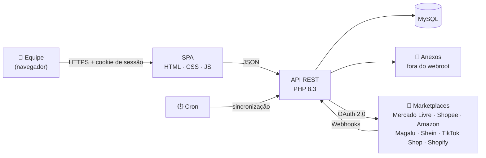

<h1 align="center">Olá, eu sou o Gustavo Cesar 👋</h1>

<p align="center">
  <a href="https://github.com/GustavoCJSilva">
    
  </a>
</p>

<p align="center">
  <a href="https://www.linkedin.com/in/gustavo-c%C3%A9sar-526791311/"></a>
  <a href="https://github.com/GustavoCJSilva"></a>
  
</p>

---

## 🧑‍💻 Sobre mim

```ts
const gustavo = {
  cargo:        "Desenvolvedor Full-Stack + IA",
  foco:         ["Sistemas web", "APIs REST", "Integrações", "Cloud"],
  ambiente:     "Sistemas corporativos e infraestrutura em nuvem",
  principios:   ["Código limpo", "Segurança por padrão", "Soluções estáveis"],
  aprendendo:   ["Arquitetura de software", "Integração com APIs de marketplaces", "IA aplicada a processos"],
  frase:        "Desenvolvimento consistente, aprendizado contínuo e foco em soluções reais.",
};
```

- 🛠️ Construo e mantenho **sistemas web completos**: interface, API, banco de dados e deploy.
- 🔌 Gosto de **automatizar processos de negócio** e integrar sistemas por API.
- ☁️ Publico e configuro ambientes em **nuvem** (AWS e hospedagem gerenciada).
- 🤖 Uso **IA no fluxo de desenvolvimento** para entregar mais rápido, sem abrir mão da qualidade.

---

## 🧰 Stack

<p align="center">
  <br/>
  <br/>
  
</p>

| Camada | Tecnologias |
|---|---|
| **Backend** | Java · .NET / C# · PHP 8 · Node.js · Python |
| **Frontend** | HTML5 · CSS3 · JavaScript (SPA sem framework) |
| **Banco de dados** | PostgreSQL · MySQL / MariaDB — modelagem relacional e documentos JSON |
| **Plataforma corporativa** |  |
| **Cloud & Deploy** | AWS (instâncias e deploy) · Hostinger · LiteSpeed/Apache |
| **Integrações** | APIs REST · OAuth 2.0 · Webhooks com assinatura HMAC |

---

## 🚀 Projeto em destaque — Sistema de Devoluções

> Sistema web em produção usado pela operação de e-commerce para controlar **devoluções de marketplaces**, conferência no CD, disputas, estoque Full e transferências. Ele substituiu uma planilha compartilhada.



| Destaque | Como foi feito |
|---|---|
| 🔐 **Autenticação própria** | Sessões por token (cookie `HttpOnly`, `Secure`, `SameSite=Strict`), senhas com `password_hash` e bloqueio após tentativas erradas |
| 👥 **Permissões por usuário** | Perfis admin e usuário, com permissões granulares (criar, editar, anexar, excluir, backup) |
| ⚔️ **Concorrência otimista** | Detecta quando dois usuários editam o mesmo registro (HTTP 409) e evita sobrescrever dados |
| 🖼️ **Anexos de imagem** | Upload com validação de tipo, redução automática no navegador, galeria, visualizador e download |
| 🔄 **Atualização em tempo real** | Todos os usuários veem as mudanças sem recarregar a página |
| 🧹 **Retenção de dados** | Exclusão automática 60 dias após a conclusão, com aviso 5 dias antes e opção de fixar urgentes |
| 🔌 **Camada de integrações** | Conectores plugáveis por marketplace, credenciais cifradas (AES-256-GCM), webhooks e upsert sem duplicar |
| 📥 **Migração de dados** | Importação da planilha antiga em Python, com fotos baixadas e anexadas automaticamente |

`PHP 8.3` `MySQL` `JavaScript` `Python` `Node.js` `REST` `OAuth 2.0` `HMAC` `AES-GCM`

---

## 📊 Atuação técnica

| Domínio | O que faço na prática |
|---|---|
| **Desenvolvimento** | Construção e manutenção de páginas, sistemas e APIs |
| **Sustentação** | Correção de falhas, melhorias funcionais e evolução de sistemas legados |
| **Dados** | Modelagem, consultas e migração de dados em bancos relacionais |
| **Deploy** | Publicação e configuração de ambientes em nuvem |
| **Plataforma** | Ajustes e suporte técnico em sistemas empresariais (Salesforce) |

---

## 🎯 Próximos passos

- [x] Colocar em produção um sistema completo, com front, API, banco e deploy
- [x] Estruturar uma camada de integrações com marketplaces
- [ ] Conectar as APIs de Mercado Livre, Shopee, Amazon e outros marketplaces
- [ ] Aprofundar em arquitetura de software, testes automatizados e CI/CD
- [ ] Consolidar carreira como desenvolvedor full-stack

---

## 📈 Atividade no GitHub

<p align="center">
  <br/><br/>
  
</p>

---

<p align="center">
  <i>Desenvolvimento consistente, aprendizado contínuo e foco em soluções reais.</i><br/><br/>
  <a href="https://www.linkedin.com/in/gustavo-c%C3%A9sar-526791311/">💼 Vamos conversar no LinkedIn</a>
</p>
