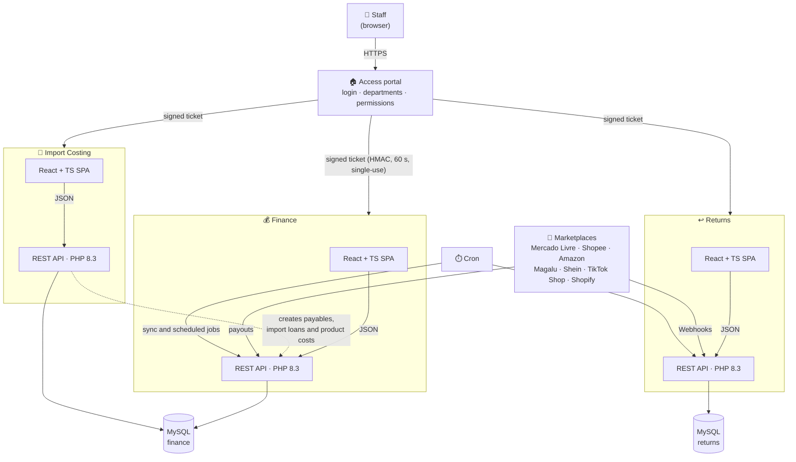

  

<h1 align="center">Hi, I'm Gustavo César 👋</h1>

  <b>Full-Stack Developer</b> · PHP · React · TypeScript · Node.js · Python · MySQL/PostgreSQL · AWS

  

  
  
  

  `n  
  

---

## 👨‍💻 About me

I'm a full-stack developer from Brazil who builds and ships **complete web systems**: UI, REST API, database, security and deploy. My most recent work is a **production platform that replaced a company's spreadsheet-driven operations** with three integrated systems (finance, import costing and returns) behind a single sign-on portal. I designed, built and maintain all of it.

What I bring to a team:

- **End-to-end ownership.** I take a feature from a vague business problem to a deployed, monitored solution, without hand-offs.
- **Business-domain fluency.** Cash flow, P&L, accounts payable/receivable, import taxes, marketplace returns. I talk to the people who use the software and turn their process into code.
- **Security by default.** HMAC-signed SSO, CSRF protection, AES-256-GCM encrypted secrets, rate limiting, optimistic locking.
- **Integrations.** REST APIs, OAuth 2.0, signed webhooks, and connectors for marketplaces (Mercado Livre, Shopee, Amazon, Shopify, TikTok Shop and others).
- **AI-assisted workflow.** I use AI tools daily to ship faster while keeping code reviewed, tested and maintainable.

---

## 🧰 Tech stack

   
   
  

| Area | Technologies |
|---|---|
| **Backend** | PHP 8 (main) · Node.js · Python · Java · C# / .NET |
| **Frontend** | React · TypeScript · Vite · JavaScript · HTML5 · CSS3 |
| **Databases** | MySQL / MariaDB · PostgreSQL · relational modeling, migrations, JSON columns |
| **Cloud & DevOps** | AWS (EC2, deploys) · Linux · Apache / LiteSpeed · cron jobs · Git / GitHub |
| **Integrations & Security** | REST · OAuth 2.0 · HMAC-signed webhooks · SSO · AES-256-GCM |
| **Enterprise platforms** |  support and customization |

---

## 🚀 Featured project: Feheros Platform

> **Problem:** a Brazilian e-commerce/import company ran finance, import costing and product returns on shared spreadsheets, with no access control, no audit trail and constant overwrite conflicts.
>
> **Solution:** a web platform, **in production and used daily**, with a central access portal and **single sign-on** into three systems. Each team member only sees the systems their department is allowed to use.
>
> **My role:** sole developer. Architecture, backend, frontend, database design, security, deploy and ongoing maintenance.

### 🏠 Access portal (SSO)

| Feature | How it works |
|---|---|
| 🔑 **Single sign-on** | Users log in once. The portal issues an HMAC-SHA256 signed ticket valid for 60 seconds and one use; each system verifies signature, audience and replay |
| 🏢 **Department-based access** | Each department unlocks a set of systems, with per-user overrides. Direct URL access is blocked without permission |
| 🛡️ **Security** | CSRF protection, forced password change on first login, lockout after 5 failed attempts, sessions revoked when permissions change |
| 🚪 **Break-glass access** | If the portal is down, an admin can still log in to each system with a local credential |

### 💰 Finance

| Feature | How it works |
|---|---|
| 📒 **Accounts payable & receivable** | Installments, recurring entries, settlement, reversal, inter-account transfers and attachments |
| 📊 **P&L and cash flow statements** | Custom chart of accounts with monthly results, balance sheet and KPIs |
| 🔮 **Cash flow forecasting** | Yearly, monthly and daily (calendar) views, custom ranges, and past months showing actuals vs. forecast |
| 🏦 **Loans** | Loan contracts with installments, auto-linked to payables, outstanding balance chart per bank |
| 🛒 **Purchasing & reconciliation** | Purchase plans and orders with approval flow, bank reconciliation from statements |
| 📥 **Spreadsheet import** | `.xlsx` and XML parsing directly in the browser, with no third-party library |

### 🚢 Import Costing

| Feature | How it works |
|---|---|
| 📂 **Document ingestion** | Reads every file of an import process at once (electronic invoice XML, closing spreadsheets, customs declaration, reconciliation) and fills the whole form |
| 🧮 **Landed cost per unit** | Computes Brazilian import taxes (II, IPI, PIS, COFINS, ICMS), allocates costs across items by CIF value and calculates the real unit cost |
| 🔗 **Finance integration** | On save, creates the payables, registers import financing as a loan and updates product costs |
| 📈 **Payback simulation** | Month-by-month projection over 24 months, including financing installments |
| 📤 **Export / re-import** | Generates `.xlsx` in the browser (zip + XML written by hand) with a hidden sheet that allows re-importing the process |

### ↩️ Returns management

| Feature | How it works |
|---|---|
| 👥 **Granular permissions** | Admin and user roles with fine-grained permissions (create, edit, attach, delete, backup) |
| ⚔️ **Optimistic concurrency** | Detects concurrent edits to the same record (HTTP 409) and prevents silent overwrites |
| 🖼️ **Photos & videos** | Chunked uploads up to 200 MB, client-side image compression, gallery and video player |
| 🔄 **Real-time updates** | Every user sees changes without reloading the page |
| 🗄️ **Archiving & audit** | Completed records are archived after 60 days (with prior notice), full change history and daily backups |
| 🔌 **Integration layer** | Pluggable connector per marketplace, encrypted credentials (AES-256-GCM), webhooks and idempotent upserts |

`PHP 8.3` `MySQL` `React` `TypeScript` `Vite` `Python` `Node.js` `REST` `SSO` `HMAC` `OAuth 2.0` `AES-GCM`

> 🔒 The source code is private (client work). I'm happy to walk through the architecture and code in a call or a screen-share.

---

## 💼 What I can help you with

| | |
|---|---|
| **Build** | New web apps, internal tools, admin dashboards and REST APIs |
| **Maintain** | Bug fixes, feature work and gradual modernization of legacy systems |
| **Integrate** | Third-party APIs, payment and marketplace platforms, webhooks, SSO |
| **Data** | Schema design, query optimization, data migrations |
| **Deploy** | Cloud setup, server configuration and production releases |

---

## 🎯 Currently

- ✅ Running a multi-system platform in production with SSO and a marketplace integration layer
- 🔄 Connecting live APIs for Mercado Livre, Shopee, Amazon and other marketplaces
- 📚 Deepening software architecture, automated testing and CI/CD
- 🌎 **Looking for remote contract roles with international teams**

---

## 🎸 Beyond code

<table>
  <tr>
    <td width="35%" align="center">
      
    </td>
<td width="65%">

🎸 **Guitar**: how I switch off after a day of coding.

🔥 **RPGs and Souls-likes**: die, learn the pattern, try again. Pretty much debugging.

🥋 **Martial arts**: discipline, consistency and respect.

📚 **Always learning**: there's always a book or a course in progress.

</td>
  </tr>
</table>

---

  <b>Let's build something together.</b>  
  <a href="mailto:gustavocjsilva@outlook.com">📧 gustavocjsilva@outlook.com</a> ·
  <a href="https://www.linkedin.com/in/gustavo-c%C3%A9sar-526791311/">💼 LinkedIn</a>

